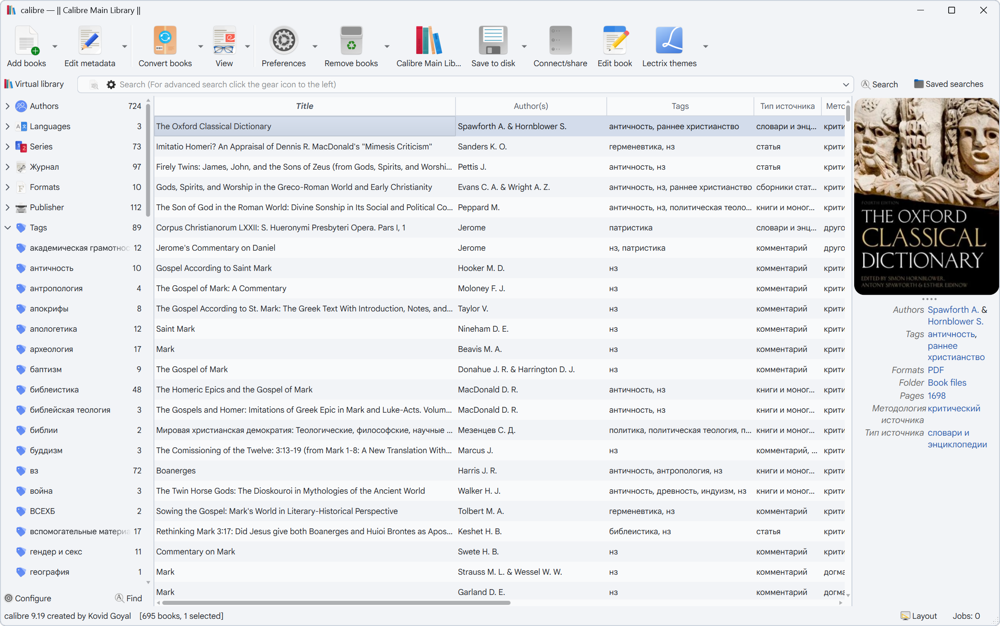
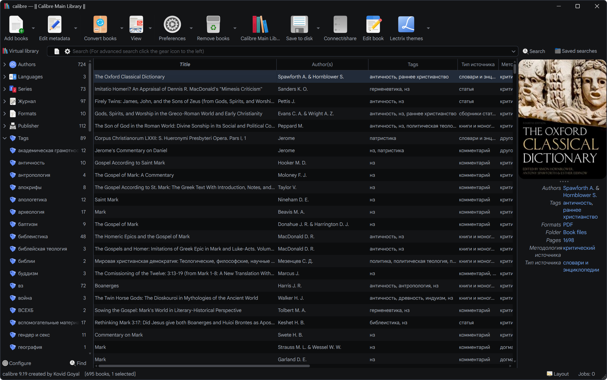
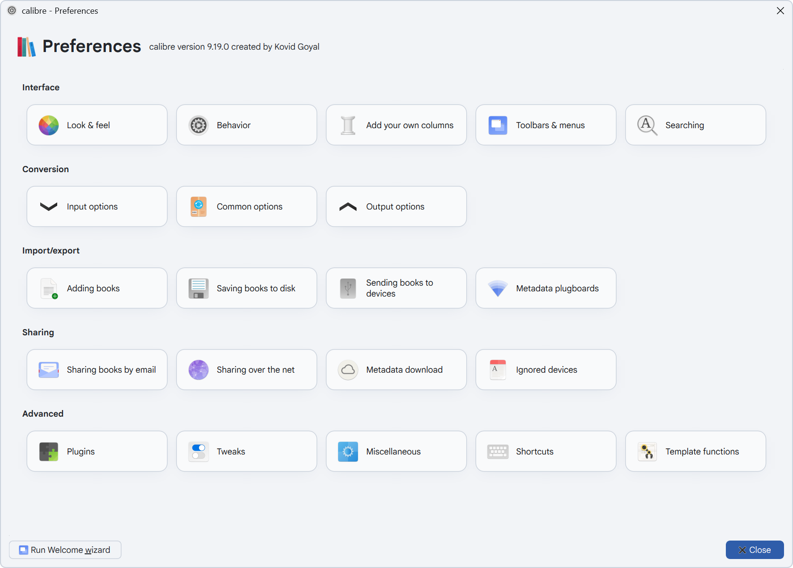
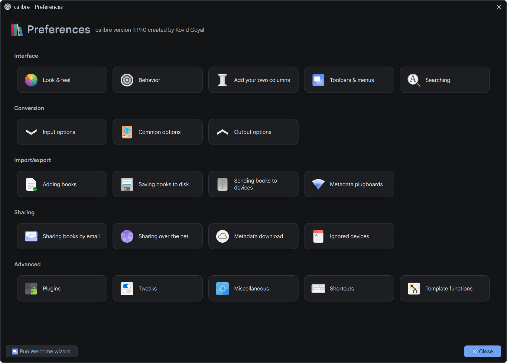
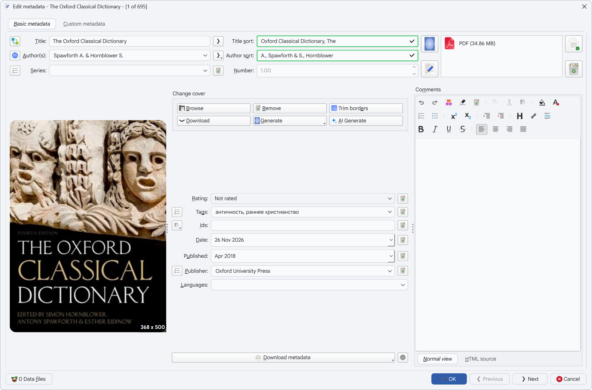
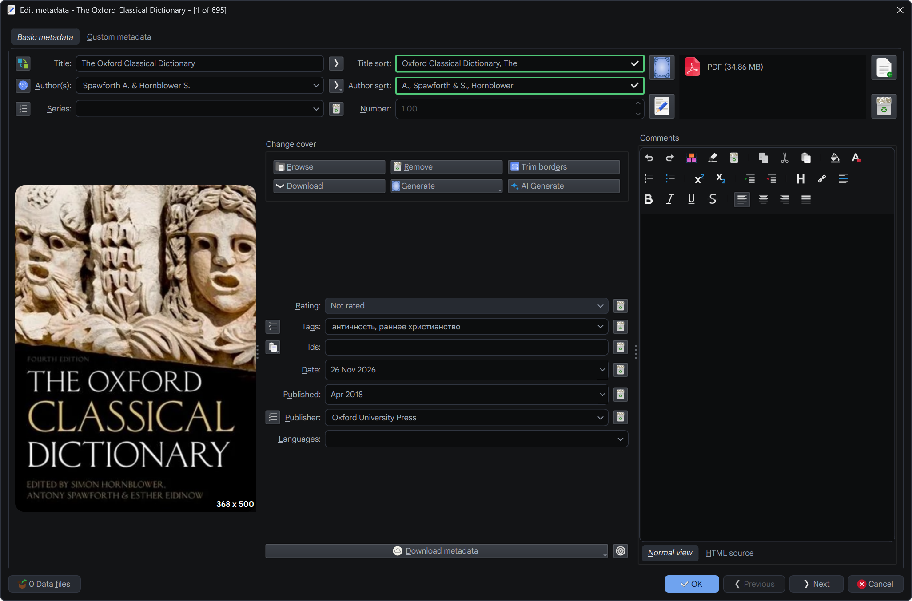
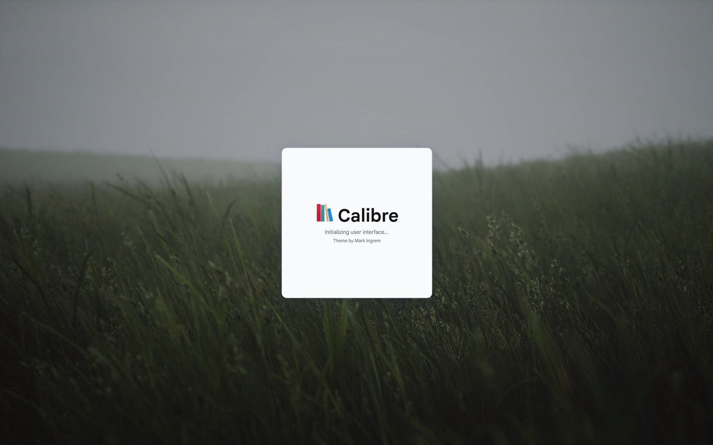
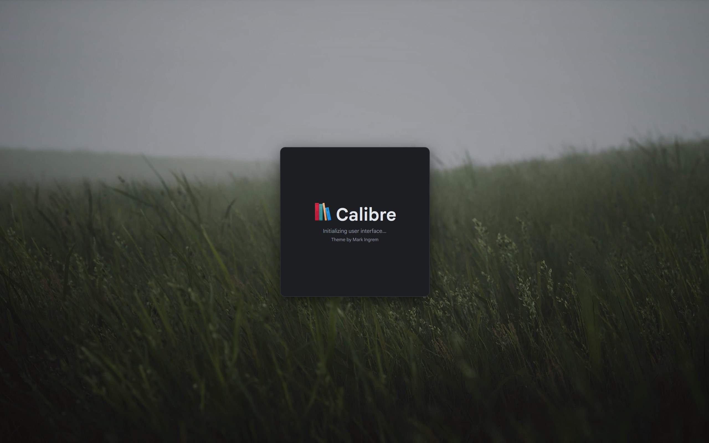

  
  <h1>Lectrix themes for calibre</h1>
  
Lectrix's light and dark themes for calibre Official pair of the <a href="https://github.com/pan4ratte/calibre-modern-gnome">Calibre Modern GNOME</a> icon theme

Lectrix's colors come from Neo's light and Midnight themes for Obsidian, tinted toward Lectrix blue. Calibre uses the theme that matches its mode, and switches when the mode changes.

  
  

The themes come as two plugins:

- **Lectrix themes**: sets calibre's light and dark colors to Lectrix's, and styles what the colors alone can't reach in the main window and its dialogs. That means the title bar, fields, buttons, checkboxes, menus, tooltips, scrollbars, tabs, the toolbar's edge, the side panels' edges, the book list's column headers, the Tag browser's hover and chevrons, the book list's current cell and the cards in Preferences. It also brings Lectrix's interface font, Google Sans Text.
- **Lectrix themes for Edit book**: the same styling and font for the book editor, plus "Lectrix light" and "Lectrix dark" syntax themes.

Needs calibre 7 or newer. The title bar colors and the round corners of menus and dropdown lists need Windows 11.

## Screenshots

Preferences:

  
  

Edit metadata:

  
  

The splash screen:

  
  

The screenshots use the [Calibre Modern GNOME](#official-icon-theme-calibre-modern-gnome) icons.

## Install

1. Download `lectrix-themes.zip` and `lectrix-themes-edit-book.zip` from the [latest release](https://github.com/pan4ratte/calibre-lectrix-themes/releases/latest).
2. In calibre, go to Preferences → Plugins → **Load plugin from file**, and load both zips. When calibre asks where to put the Lectrix themes button, pick the main toolbar. Restart calibre.
3. In Preferences → Look & feel → Main interface, make sure "User interface style" is **calibre**. Calibre ignores custom colors with the "System" style.

Calibre's mode is set under **Adjust colors** → "Color palette": Light, Dark, or System default to follow Windows.

### The colors

Lectrix themes sets the light and dark colors in Adjust colors to Lectrix's on its first start, and again only when an update changes them. Changes you make in Adjust colors in between are kept. All of calibre's windows read these colors, the e-book viewer and the editor included.

### The font

While the theme is on, calibre's interface font is Google Sans Text, Lectrix's font, at the size calibre had. The plugins carry it, so nothing is installed in Windows. It covers Latin, Greek and Cyrillic; other scripts are drawn in the system's fonts. If you've picked a font in Look & feel → Main interface → **Interface font**, yours stays; calibre's own default, Segoe UI, doesn't count as picked. To keep calibre's font, right-click **Lectrix themes** on the toolbar and untick **Use Lectrix's font**. The font doesn't reach book text or the e-book viewer.

### The splash screen

While the theme is on, calibre starts with a Lectrix splash in place of its own: a card with round corners in the mode's colors and font, a soft shadow, and calibre's icon from the icon theme you use, such as Calibre Modern GNOME. Look & feel → Main interface → **Show splash screen at startup** turns it off, as it does calibre's.

### The app icon

While the theme is on, calibre's icon is the calibre icon of the icon theme you use, in place of calibre's own: on the main window and its dialogs, in Alt+Tab, in the tray, and on calibre's shortcuts on your taskbar, your desktop and your own Start menu. For the shortcuts, the plugin saves the icon as `calibre.ico` in calibre's settings folder, under `plugins/lectrix_themes`, and points them at it. Windows may take a moment, or a sign-out, to show the new icon on a pinned taskbar button.

Some places keep calibre's icon: the Start menu entry calibre's installer makes, which only an administrator can change, `calibre.exe` itself, and the e-book viewer, where calibre doesn't load plugins.

### The toolbar button

Click **Lectrix themes** on the toolbar to switch calibre between light and dark. Right-click it, or click its arrow, for the rest:

- **Light**, **Dark** and **System default**, calibre's Color palette choices from Adjust colors;
- **Use the Lectrix theme**, to turn the theme on and off;
- **Use Lectrix's font**, to turn Google Sans Text on and off.

### The book editor

The editor plugin selects the Lectrix syntax theme on its first start, and swaps between the light and dark one as calibre's mode changes. If you pick another theme in the editor's Preferences → Editor settings, that one stays. The plugin rewrites the two Lectrix themes at each start, so changes to them are lost. To make your own version, create a new theme based on one of them under another name.

### Turning it off

Right-click **Lectrix themes** on the toolbar and untick **Use the Lectrix theme**, or untick it in Preferences → Plugins → Lectrix themes → **Customize plugin**. Everything is undone at once:

- the colors you had before come back, in both modes;
- the title bar, field, button and menu styling goes;
- calibre's own interface font comes back;
- calibre's own splash screen comes back, at the next start;
- calibre's own icon comes back, on its windows and its shortcuts;
- the book editor goes back to calibre's automatic syntax theme, the next time it starts.

Calibre doesn't tell plugins when they're removed, so untick this before removing the plugin. If you already removed it, use Adjust colors → **Restore defaults**, and set your calibre shortcuts' icons back in their Properties → **Change Icon**.

### Colors only, without the plugins

`lectrix.calibre-palette`, also in the release, holds the same light and dark colors for calibre's own palette import. Click **Adjust colors**, then **Import**, and choose the file. You get Lectrix's colors without the title bar, field and menu styling.

## Official icon theme: Calibre Modern GNOME

[Calibre Modern GNOME](https://github.com/pan4ratte/calibre-modern-gnome) is the official icon theme for Lectrix themes, by the same author. Its clean, modern icons, based on Ubuntu's Yaru-Blue style, suit the themes' flat look. It's a separate project, so each works without the other.

The theme is in alpha testing and has no release package yet. Until it does, install it with calibre's own way of replacing icons:

1. In calibre, open Preferences → Advanced → Miscellaneous, and click **Open calibre configuration folder**.
2. Create a `resources` folder there if it doesn't exist. Copy the theme's `images` folder into it, so the icons end up in `resources/images`.
3. Restart calibre.

To go back to calibre's own icons, delete `resources/images` and restart.

## Building

All colors live in [src/lectrix_theme.py](src/lectrix_theme.py). `python build.py` writes the palette file from it and packs both plugins into `dist/`. Each plugin carries a copy of the shared modules, `lectrix_theme.py` and `chrome.py`. The main plugin notices any change to the palette colors there and applies them again after an update.

## License

GPL v3, like calibre itself. See [LICENSE](LICENSE).

The plugins carry Google Sans Text 14.000 from the [official release](https://github.com/googlefonts/googlesans/releases/tag/v14.000), © 2025 The Google Sans Project Authors, under the SIL Open Font License 1.1: see [src/fonts/OFL.txt](src/fonts/OFL.txt). It is cut down to Latin, Greek and Cyrillic, without the Google logo ligatures, by [tools/subset_fonts.py](tools/subset_fonts.py). "Google" and "Google Sans" are trademarks of Google LLC; this project isn't affiliated with Google.
